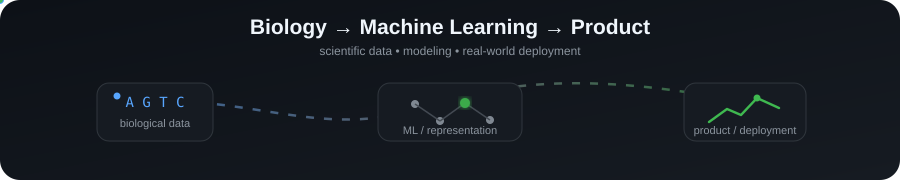

<h1 align="center">Hey, I'm Luis 👋</h1>

<b>Yale Computational Biology · UW Biochemistry + Data Science · Biology × ML × Product</b>

  

  <a href="https://ylc22.github.io/">Personal Website</a> ·
  <a href="https://github.com/ylc22">GitHub</a> ·
  <a href="https://leetcode.com/u/luischan22/">LeetCode</a>

  

## 👋 About me, but in bullets

- 🧬 **Yale MS in Computational Biology & Bioinformatics**
- 🧪 **UW BS in Biochemistry + Data Science**
- 🤖 I like **ML for biology**, especially protein, clinical, and bioinformatics problems
- 🛠️ I’ve worked across **research, product, solutions engineering, and scientific platforms**
- 🧠 I enjoy turning messy science into something people can actually use
- 📦 I like projects that go all the way from **data → model → product**
- 🚫 I am not emotionally attached to notebooks named `final_v7_REAL.ipynb`

## 🧪 Things I’ve worked on

- 🧬 **Protein design / protein ML**
  - Baker Lab / Institute for Protein Design
  - OpenProtein.AI
  - Shape Therapeutics

- 🏥 **Bioinformatics + scientific infrastructure**
  - NIH-facing workflows
  - Nextflow
  - clinical / biomedical data
  - cloud deployments

- 🧑‍💻 **Life-sciences solutions engineering**
  - Domino Data Lab
  - ML demos
  - scientific workflows
  - “how do we make this actually work for users?”

## 🚀 Featured projects

- 🧬 [**Protein Property Predictor**](https://github.com/ylc22/protein-property-predictor)
  - protein ML
  - interpretable sequence features
  - API + Streamlit + CI
  - considerably less toy-ish than its first version

- 🧪 [**RNAseq Insight**](https://github.com/ylc22/rnaseq-insight)
  - RNA-seq analysis
  - PCA
  - differential expression
  - FDR control
  - reproducible workflows

- 🏥 [**Clinical Risk Lab**](https://github.com/ylc22/clinical-risk-lab)
  - calibrated healthcare ML
  - subgroup auditing
  - explainability
  - validation

- 🥊 [**UFC Vibes Lab**](https://github.com/ylc22/ufc-vibes-lab)
  - unsupervised clustering
  - fighter archetypes
  - “Human Backpack Score”
  - proof that data science does not always have to look miserable

## 🌍 Open-source contributions

- 🧩 I contribute to public repositories when I can add something concrete rather than drive-by noise
- 📝 Recent example: implementation guidance on [PITBridge #7](https://github.com/dev-belly/PITBridge/issues/7) around pandas/CSV adapters, temporal validation, revisions, tombstones, and missing-value handling
- 🔍 I like contributions where I can read the existing contract first, identify edge cases, and leave something maintainers can actually use
- 🦈 More merged PRs coming; less “changed one comma for the graph”

## 🧠 My preferred workflow

- find an interesting problem
- get the data
- clean the data
- complain about the data
- clean it again
- build the model
- realize the simple baseline is annoyingly strong
- build something people can actually interact with
- add tests so Future Luis does not hate Past Luis

## 🛠️ Tools I use

  
  
  
  
  
  
  
  

## 📈 GitHub stuff

  
  

  

## 📈 Contribution activity

## 🧩 LeetCode

  

## ⚽ Outside of work

- ⚽ soccer
- 🏀 basketball
- 🏃 running
- 🥊 kickboxing
- 🥋 BJJ
- ♟️ chess
- 🎹 piano
- 💪 gym

## 💬 A line I like

> “The credit belongs to the man who is actually in the arena.” — Theodore Roosevelt

---

### TL;DR

- biology person who likes ML
- ML person who still cares about biology
- likes building things people can use
- likes serious work
- does not believe serious work has to look serious all the time

---

**Search terms:** Luis Chan Yale · Luis Chan Yale University · Luis Chan University of Washington · Luis Chan computational biology · Luis Chan bioinformatics · Luis Chan machine learning · ylc22 GitHub
