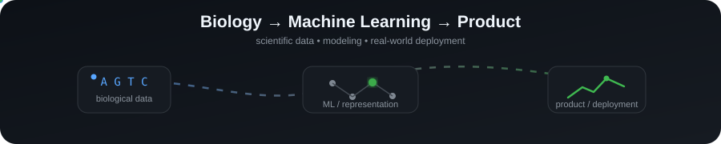

<h1 align="center">Hey, I'm Luis 👋</h1>

  <b>Computational Biology · Machine Learning · Scientific Platforms</b> 
  Yale MS · UW Biochemistry + Data Science

  <a href="https://ylc22.github.io/"><b>Website</b></a> ·
  <a href="https://github.com/ylc22"><b>GitHub</b></a> ·
  <a href="https://leetcode.com/u/luischan22/"><b>LeetCode</b></a>

  

  

## About

| | |
|---|---|
| 🧬 **Focus** | Computational biology, ML for science, bioinformatics platforms |
| 🎓 **Education** | Yale MS Computational Biology & Bioinformatics · UW BS Biochemistry + Data Science |
| ⚙️ **Build** | Data → model → API → product |
| 🤝 **Work style** | Research · product · solutions · scientific infrastructure |
| 🌎 **Background** | 🇭🇰 Hong Kong · 🇲🇴 🇵🇹 Macau / Portuguese roots |

## Featured projects

| Project | What it shows |
|---|---|
| ⚙️ [**Scientific Workflow Control Plane**](https://github.com/ylc22/scientific-workflow-control-plane) | FastAPI · orchestration · retries · cancellation · metrics · Docker · CI |
| 🧬 [**Protein Property Predictor**](https://github.com/ylc22/protein-property-predictor) | Protein ML · interpretable sequence features · API · Streamlit |
| 🧪 [**RNAseq Insight**](https://github.com/ylc22/rnaseq-insight) | RNA-seq · PCA · differential expression · FDR · reproducibility |
| 🏥 [**Clinical Risk Lab**](https://github.com/ylc22/clinical-risk-lab) | Calibrated ML · subgroup auditing · explainability · model validation |
| 🥊 [**UFC Vibes Lab**](https://github.com/ylc22/ufc-vibes-lab) | Clustering · fighter archetypes · exploratory data science |

## Experience across

  🧬 Protein ML &nbsp;&nbsp;•&nbsp;&nbsp;
  🏥 Biomedical AI &nbsp;&nbsp;•&nbsp;&nbsp;
  ☁️ Scientific Platforms &nbsp;&nbsp;•&nbsp;&nbsp;
  🤝 Solutions & Product

  Baker Lab / Institute for Protein Design · OpenProtein.AI · Shape Therapeutics · Domino Data Lab · NIH-facing bioinformatics

## Toolkit

  
  
  
  
  
  
  

## GitHub

  
  

  

## Outside of work

  ⚽ Soccer &nbsp;·&nbsp;
  🏀 Basketball &nbsp;·&nbsp;
  🏃 Running &nbsp;·&nbsp;
  🥊 Kickboxing &nbsp;·&nbsp;
  🥋 BJJ &nbsp;·&nbsp;
  ♟️ Chess &nbsp;·&nbsp;
  🎹 Piano &nbsp;·&nbsp;
  📚 Reading

  <i>“The credit belongs to the man who is actually in the arena.”</i> 
  Theodore Roosevelt

